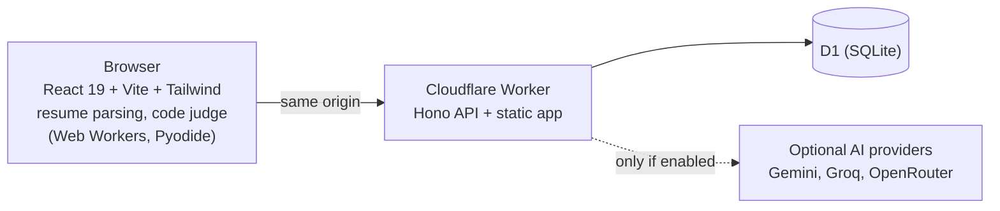

<div align="center">


# PrepWise

**Placement preparation for engineering students. Free to run, always on, and built to work without AI.**

[](https://github.com/raghuldpr/PrepWise-App/actions/workflows/ci.yml)
[](https://prepwise-api.prepwise-api.workers.dev)


[Live app](https://prepwise-api.prepwise-api.workers.dev) · [Features](#features) · [Getting started](#getting-started) · [Architecture](#architecture) · [Deploy](#deploy-for-free) · [Docs](#documentation)

</div>

---

## Overview

PrepWise helps students get ready for campus placements in one place: practise aptitude and core subjects, check a resume, find skill gaps and get a study plan, rehearse interviews, and solve coding problems, all from the browser.

It was rebuilt from a Spring Boot and MySQL project into a modular app that:

- **costs nothing to host.** It runs on the Cloudflare Workers and D1 free tiers.
- **never sleeps.** There is no cold-start backend to wake up.
- **minimises AI.** Resume analysis, roadmaps, interview scoring and the code judge are rules and curated content, so results are instant, repeatable and explainable. The one AI feature, an assistant, is optional and off by default.

## Features

| Module | What you get | How it works |
|---|---|---|
| **Accounts and onboarding** | Register, log in, profile, skills and goals, settings | httpOnly session cookie, login lockout, log out of all devices |
| **Practice** | 210 multiple-choice questions across aptitude, technical, DSA and HR topics; progress, accuracy and weak areas | Answers graded on the server; progress per category |
| **Companies** | Company profiles and preparation material | Curated content |
| **Resume Analyzer** | A 100-point score with a breakdown, skills found and missing for your role, fixes, and match against a job description | PDF and DOCX are read **in your browser**; the file is never uploaded |
| **Skill Gap, Roadmap, Study Plan** | What you cover, what to improve and what is missing for a role; a phased learning roadmap; a dated weekly plan that fits your hours | Prerequisite graph of 62 topics, 9 role profiles; says plainly when the plan does not fit |
| **Project Finder** | 28 portfolio projects ranked for your role and gaps, with build plans | Rule-based ranking with reasons |
| **Mock Interview** | Technical, HR and mixed rounds with adaptive difficulty, a detailed report and history | 71 technical and 16 HR questions scored by which key ideas an answer covers |
| **Coding Practice** | 27 problems with 205 tests; write JavaScript or Python and run it instantly | Code runs in a Web Worker on your device; infinite loops are stopped after 2 seconds |
| **AI Assistant** *(optional)* | Chat with image upload for screenshots of questions or errors | Gemini, Groq and OpenRouter with automatic fallback; off until you add a key |

Every module is explained, with what was verified and its known limits, in the [iteration documents](#documentation).

## Branding

<table>
<tr>
<td width="140"></td>
<td>

The mark is a **P** with a rising arrow: progress toward the offer letter.

| | Colour | Hex |
|---|---|---|
|  | Navy, the letterform | `#0F1C52` |
|  | Green, the arrow | `#00B37A` |
|  | Terracotta, the app's accent | `#C85232` |
|  | Warm sand, the app's surfaces | `#EAE6DF` |

</td>
</tr>
</table>

## Architecture



- **One Worker serves everything.** The built React app and the `/api` routes share one origin, so cookies are first-party and there is no CORS.
- **Heavy work happens in the browser.** The Workers Free plan allows only about 10 ms of CPU per request, so PDF parsing, text analysis and running code are done client-side.
- **Content lives in code, not in the database.** Questions, roles, topics, projects and coding problems are versioned files that cost no database reads.

### Tech stack

| Layer | Technology |
|---|---|
| Frontend | React 19, Vite 6, Tailwind CSS 4, React Router |
| API | Hono on Cloudflare Workers, zod validation |
| Database | Cloudflare D1 (SQLite) with Drizzle ORM and migrations |
| Auth | JWT in an httpOnly cookie, PBKDF2 with a server-side pepper |
| Browser runners | Web Workers, Pyodide (Python), pdf.js and mammoth (resumes) |
| Tests | Vitest unit tests and Node smoke suites |
| CI/CD | GitHub Actions, Wrangler |

### Project structure

```
apps/
  api/              Hono Worker, D1 schema and migrations, routes
  web/              React app and the browser-side code runners
packages/
  content/          Questions, roles, topics, projects, interview bank, coding problems
  core/             Pure, tested logic: resume, learning, interview, coding judge, AI chain
  shared/           Schemas shared by the API and the web app
scripts/            Smoke tests, stress tests, content authoring and verification
docs/               One page per iteration, demo script, assets
```

## Getting started

**You need:** Node.js 22 or newer and Git. A Cloudflare account is only needed to deploy.

```bash
git clone https://github.com/raghuldpr/PrepWise-App.git
cd PrepWise-App
npm install
```

**1. Create your local secrets.** Copy the example file, then replace the two placeholder values with long random strings. Never commit this file; it is git-ignored.

```bash
cp apps/api/.dev.vars.example apps/api/.dev.vars       # Windows PowerShell: copy apps\api\.dev.vars.example apps\api\.dev.vars
node -e "console.log(require('crypto').randomBytes(48).toString('base64url'))"    # run twice: one value for each secret
```

**2. Create the local database and build the app.**

```bash
cd apps/api
npx wrangler d1 migrations apply prepwise-db --local
cd ../..
npm run build -w @prepwise/web
```

**3. Start it.**

```bash
cd apps/api
npx wrangler dev --local
```

Open http://localhost:8787, register an account and follow onboarding. For hot reloading of the frontend, run `npm run dev:web` in a second terminal and open http://localhost:5173; it proxies the API to port 8787.

## Testing

```bash
npm test                                   # unit tests
npx tsc -p apps/api --noEmit               # type check
node scripts/smoke.mjs http://localhost:8787
```

Eight smoke suites run against a live Worker, local or deployed: `smoke`, `smoke-practice`, `smoke-resume`, `smoke-learning`, `smoke-interview`, `smoke-coding`, `smoke-security` and `smoke-ai`. Pull requests and pushes run them in CI against a throwaway local database.

Useful tools: `scripts/author-coding-problems.mjs` regenerates the coding bank and cross-checks every expected output with an independent Python solution, `scripts/check-links.mjs` checks every learning resource link, and `scripts/stress-*.mjs` check worst-case CPU use against production.

## Deploy for free

1. Log in and create the database: `npx wrangler login`, then `npx wrangler d1 create prepwise-db`. Put the database id it prints into `apps/api/wrangler.toml`.
2. Set the production secrets (paste random values when asked; they are stored by Cloudflare, not in this repository):
   ```bash
   cd apps/api
   npx wrangler secret put JWT_SECRET
   npx wrangler secret put PASSWORD_PEPPER
   ```
3. Build and deploy:
   ```bash
   npm run build -w @prepwise/web
   cd apps/api
   npx wrangler d1 migrations apply prepwise-db --remote
   npx wrangler deploy
   ```
4. **Automatic deploys:** add two repository secrets under Settings, Secrets and variables, Actions: `CLOUDFLARE_ACCOUNT_ID` and `CLOUDFLARE_API_TOKEN` (a token with Workers and D1 edit permission). After that, every push to `main` runs the tests and smoke suites, applies migrations and deploys.

### Free-tier limits that shaped the design

| Cloudflare Workers Free | |
|---|---|
| Worker requests | 100,000 per day |
| CPU time per request | 10 ms |
| Subrequests per request | 50 |
| Static files | Free and unlimited |

| Cloudflare D1 Free | |
|---|---|
| Rows read | 5 million per day |
| Rows written | 100,000 per day |
| Storage | 5 GB total, 500 MB per database |
| Queries per request | 50 |

As a rough estimate, this is enough for a few hundred active students a day. Limits change; confirm them in Cloudflare's documentation.

### Optional AI assistant

Off by default. To enable it, add a provider key as a Worker secret (`npx wrangler secret put GEMINI_API_KEY`, and optionally `GROQ_API_KEY` and `OPENROUTER_API_KEY`), run `node scripts/check-ai-providers.mjs` to confirm the model names work for your keys, then set `AI_ENABLED = "true"` in `apps/api/wrangler.toml` and redeploy. Messages and images go to the chosen provider, so the page shows a privacy notice. Details: [docs/ITERATION-7.md](docs/ITERATION-7.md).

## Security

- **No secrets in this repository.** Keys and signing secrets live in git-ignored local files or Cloudflare and GitHub secrets. Only `apps/api/.dev.vars.example`, with placeholders, is committed. Values such as database ids and the public URL are identifiers, not credentials. The test scripts contain throwaway passwords for temporary test accounts only.
- Session cookie is httpOnly and SameSite=Lax with a 7-day life, and state-changing requests are checked by origin.
- Passwords are hashed with PBKDF2 (the Workers maximum of 100,000 iterations) plus a server-side pepper.
- Five failed logins lock an account for 15 minutes. "Log out of all devices" and changing the password end every other session at once.
- API responses are not cacheable; the app sends frame blocking, HSTS and a Content-Security-Policy on its pages.
- Code you run in Coding Practice executes in a Web Worker on your own device. The server cannot verify the result, so coding progress is for practice, not ranking.

Found a vulnerability? Please open a private security advisory on GitHub rather than a public issue.

## Known limitations

- Questions, interview key ideas, role requirements, study hours and coding statements were drafted by the author and still need review by someone who teaches the subject.
- Interview scores measure which expected ideas are mentioned, not whether they are correct. The report says so.
- 9 role profiles; coding supports JavaScript and Python with function-style problems only.
- No password reset or email verification yet (both need an email service).
- The AI assistant is optional and has only been tested against a mock provider.

## Documentation

| | |
|---|---|
| [Iteration 0](docs/ITERATION-0.md) | Scaffold and feasibility spikes |
| [Iteration 1](docs/ITERATION-1.md) | Accounts, profile and onboarding |
| [Iteration 2](docs/ITERATION-2.md) | Practice, progress and companies |
| [Iteration 3](docs/ITERATION-3.md) | Resume analyzer |
| [Iteration 4](docs/ITERATION-4.md) | Skill gap, roadmap, study plan, projects |
| [Iteration 5](docs/ITERATION-5.md) | Mock interview |
| [Iteration 6](docs/ITERATION-6.md) | Coding practice |
| [Iteration 7](docs/ITERATION-7.md) | Optional AI assistant |
| [Iteration 8](docs/ITERATION-8.md) | Hardening, CI and docs |
| [Demo script](docs/DEMO.md) | A 10-minute walkthrough |

## Contributing

Issues and pull requests are welcome. Run the unit tests and the smoke suites before opening a pull request, and never include keys, tokens or personal data in commits or screenshots.

## License

No license has been chosen yet, so all rights are reserved by default. If you want others to use or contribute to the code, add a `LICENSE` file (for example MIT).

---

<div align="center">
<br />
<sub><b>PrepWise</b> · Prepare smarter. Get placed.</sub>
</div>
